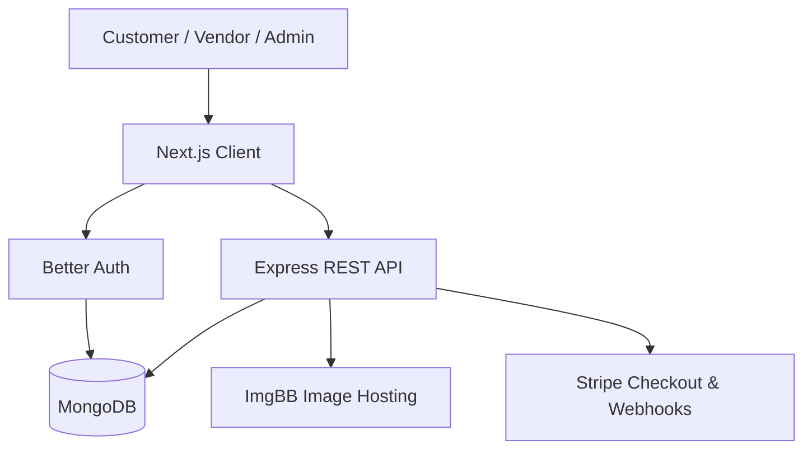

# 🍕 PizzaHub

<div align="center">


### Discover. Order. Enjoy.

**A modern pizza marketplace connecting hungry customers with local pizza vendors.**

·[🌐 Live Website] https://pizzahub-tasdid.vercel.app 
·[⚙️ Backend API] https://pizzahub-api-tasdid.vercel.app 
·[💻 Client Repository] https://github.com/tasdid-ahmed/pizzahub-client 
·[🛠️ Server Repository] https://github.com/tasdid-ahmed/pizzahub-server

</div>

---

## 📖 About PizzaHub

PizzaHub is a full-stack pizza marketplace where customers can explore pizza menus, discover local vendors, and place orders, while restaurant vendors can manage their menus and incoming orders through dedicated dashboards.

The platform features role-based experiences for **Customers, Vendors, and Admins**, with menu moderation, order management, vendor subscriptions, and dashboard analytics — all wrapped in a responsive interface with light and dark themes.

> Built to bring local pizza vendors and pizza lovers together in one place. 🍕

---

## ✨ Features

### 🛒 Customer Experience
- Browse approved pizza and food items from different vendors.
- Search menus by name or description.
- Filter items by category, location, and price range.
- Sort menus by newest or price.
- View detailed menu information.
- Place orders with delivery date, address, and optional instructions.
- Track order status and view order history.
- Cancel eligible pending orders.
- Personalized customer dashboard with statistics and order analytics.

### 🏪 Vendor Dashboard
- Dedicated vendor dashboard and profile settings.
- Create, edit, and manage menu listings.
- Upload menu images.
- Submit new menu items for admin approval.
- Control item availability.
- Manage incoming orders and accept or reject requests.
- View menu and order statistics.
- Manage Free and Premium subscription plans.

### 🛡️ Admin Dashboard
- Platform overview and analytics.
- Manage registered users.
- Block or unblock user accounts.
- Review submitted menu items.
- Approve, reject, or deactivate menu listings.
- View transaction records.
- Monitor platform activity through dashboard statistics and charts.

### 📊 Dashboard Analytics
- Order status visualization for customers and vendors.
- User composition analytics for administrators.
- Menu item status visualization.
- Statistics powered by actual backend data.

### 🔐 Authentication & Security
- Email and password authentication.
- Google sign-in.
- Role-based access to dashboards and features.
- Protected routes.
- JWT-based authentication for API requests.
- Account blocking support.
- Validated profile updates.

### 💎 Vendor Subscription
- Free plan with a limit of 3 live menu items.
- Premium monthly subscription.
- Stripe Checkout integration.
- Subscription cancellation at the end of the current billing period.
- Premium vendor visibility and featured menu placement.

---

## 🧑‍🍳 User Roles

| Role | Access & Responsibilities |
|---|---|
| 🛒 Customer | Browse menus, place orders, manage orders, and view personal dashboard |
| 🏪 Vendor | Manage menu listings, availability, orders, and subscription |
| 🛡️ Admin | Manage users, moderate menu items, review transactions, and monitor platform statistics |

---

## 🖥️ Dashboard Preview

> 📸 Screenshots will be added here.

<!-- Replace the paths below with screenshots committed to your repository. -->

<!--
<div align="center">
  
  <p><b>Homepage</b></p>

  
  <p><b>Menu browsing experience</b></p>

  
  <p><b>Customer dashboard</b></p>

  
  <p><b>Vendor dashboard</b></p>

  
  <p><b>Admin dashboard</b></p>
</div>
-->

---

## 🧰 Tech Stack

### Frontend


### UI & Visualization


### Authentication & Data


### Tools & Deployment


---

## 🏗️ Architecture

PizzaHub uses a separate frontend and backend architecture.



- **Next.js Client:** User interface, dashboards, authentication, and client-side interactions.
- **Better Auth:** Authentication, sessions, Google sign-in, and JWT generation.
- **Express API:** Menu management, orders, subscriptions, admin operations, and protected endpoints.
- **MongoDB:** Persistent application data.
- **ImgBB:** Menu image hosting.
- **Stripe:** Vendor subscription checkout and payment processing.

---

## 📁 Project Structure

```text
src/
├── app/
│   ├── (auth)/             # Sign-in, sign-up, role selection
│   ├── (public)/           # Homepage, menu, item details, payment pages
│   ├── dashboard/
│   │   ├── customer/       # Customer dashboard & orders
│   │   ├── vendor/        # Vendor dashboard & menu management
│   │   └── admin/         # Admin dashboard & management
│   └── api/auth/           # Better Auth API route
│
├── components/
│   ├── layout/             # Navbar, footer, dashboard shell
│   ├── providers/          # Theme provider
│   ├── shared/             # Shared UI components
│   └── ui/                 # Reusable UI primitives
│
├── features/
│   ├── admin/              # Admin management
│   ├── auth/               # Authentication UI
│   ├── dashboard/           # Dashboard overview & navigation
│   ├── home/                # Homepage sections
│   ├── menu/                # Menu browsing & management
│   ├── orders/              # Order workflow
│   ├── profile/             # Profile settings
│   └── subscription/         # Premium subscription UI
│
├── lib/                     # Auth, API, DB, validation & utilities
└── types/                   # TypeScript definitions
```

---

## 🚀 Getting Started

### Prerequisites

- Node.js (LTS recommended)
- npm
- MongoDB database
- Google OAuth credentials (for Google sign-in)
- Running PizzaHub backend API

### 1. Clone the repository

```bash
git clone https://github.com/tasdid-ahmed/pizzahub-client.git
cd pizzahub-client
```

### 2. Install dependencies

```bash
npm install
```

### 3. Configure environment variables

Create a `.env` file in the project root based on `.env.example`.

```bash
cp .env.example .env
```

Update the environment values:

| Variable | Description |
|---|---|
| `BETTER_AUTH_SECRET` | Secret used by Better Auth |
| `BETTER_AUTH_URL` | Base URL of the Next.js application |
| `MONGODB_URI` | MongoDB connection string |
| `MONGODB_DB` | MongoDB database name (default project database: `pizzahub`) |
| `GOOGLE_CLIENT_ID` | Google OAuth client ID |
| `GOOGLE_CLIENT_SECRET` | Google OAuth client secret |
| `NEXT_PUBLIC_API_URL` | Backend deployment base URL (without `/api`) |

> **Important:** Keep all secret values in environment variables. Never commit your `.env` file.

### 4. Start the development server

```bash
npm run dev
```

Open [http://localhost:3000](http://localhost:3000) in your browser.

### 5. Available scripts

| Command | Description |
|---|---|
| `npm run dev` | Start development server |
| `npm run build` | Build for production |
| `npm run start` | Start production server |
| `npm run lint` | Run ESLint |

---

## 🔑 Demo Access

### Live Application

| Resource | Link |
|---|---|
| Live Client | https://pizzahub-tasdid.vercel.app |
| Backend API | https://pizzahub-api-tasdid.vercel.app |
| Client GitHub | https://github.com/tasdid-ahmed/pizzahub-client |
| Server GitHub | https://github.com/tasdid-ahmed/pizzahub-server |

### Admin Account

Use the following demo credentials to explore the administrative features, if a demo account is available.

| Field | Demo Value |
|---|---|
| Admin Email / User ID | `YOUR_DEMO_ADMIN_EMAIL_OR_ID` |
| Admin Password | `YOUR_DEMO_ADMIN_PASSWORD` |

> Replace these placeholders with a dedicated demo account before publishing. Do not use personal credentials or expose production account passwords in the repository.

---

## 🌐 Environment & Deployment

The client is designed to be deployed independently from the backend API.

**Recommended deployment:** [Vercel](https://vercel.com/)

Before deployment, configure the environment variables in the hosting platform and ensure:

- `BETTER_AUTH_URL` matches the deployed frontend URL.
- MongoDB credentials are configured securely.
- Google OAuth redirect URLs are configured for the deployed domain.
- `NEXT_PUBLIC_API_URL` points to the deployed backend.
- Backend CORS allows the deployed frontend origin.

---

## 🎨 UI Highlights

- Responsive layouts for desktop, tablet, and mobile.
- Light and dark themes.
- Role-aware dashboard navigation.
- Modern component-driven architecture.
- Data visualization for quick dashboard insights.
- Interactive menus, filters, dialogs, and forms.

---

## 🔒 Security Notes

- Environment files are excluded from Git.
- Authentication is handled by Better Auth.
- API access uses JWT authentication.
- Role-specific access is enforced by the backend.
- Admin privileges are not available through normal role selection.
- User profile updates are validated.

---

## 🤝 Related Repository

PizzaHub is split into two repositories:

- **Client:** Next.js frontend and Better Auth integration.
- **Server:** Express API, MongoDB operations, order management, subscriptions, and admin services.

See the backend repository for API documentation and server setup.

---

<div align="center">

### Made with 🍕 and code.

**PizzaHub — Bringing pizza lovers and local vendors together.**

</div>
